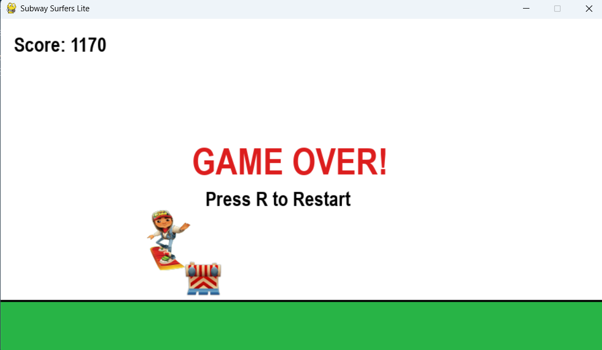

🎮 Subway Surfers Lite – Python Game

A fun and interactive endless runner game developed using Python and Pygame, inspired by the popular Subway Surfers game. The game challenges players to avoid obstacles, survive as long as possible, and achieve the highest score.

📸 Game Preview

📌 Project Overview

Subway Surfers Lite is a 2D endless runner game developed using Python and the Pygame library.

The main objective of this project is to create a simple yet engaging gaming experience where players control a character, avoid obstacles, and try to achieve the highest possible score.

The game includes a scoring system, obstacle challenges, a Game Over screen, and a restart option.

🎯 Game Features

1. Player Movement: Control the character during gameplay.
2. Obstacle Avoidance: Avoid obstacles to keep the game running.
3. Score System: Earn points while playing.
4. Game Over Screen: Displays the final score when the game ends.
5. Restart Option: Press R to restart the game.
6. Interactive Gameplay: Enjoy a simple and engaging endless runner experience.

🛠️ Tools & Technologies

* Python: Main programming language used for game development.
* Pygame: Used for game graphics, animations, events, and gameplay.
* Random: Used for random game elements.
* Sys: Used for system-related operations.
* OS: Used for operating system-related file operations.

📚 Python Libraries Used

import pygame
import random
import sys
import os

🎮 How to Play

* Start the game.
* Control your character to avoid obstacles.
* Try to achieve the highest score.
* If the game ends, press R to restart.

🎯 Project Objective

The objective of this project is to improve Python programming and game development skills by building an interactive 2D endless runner game using Pygame.

This project demonstrates basic game development concepts, event handling, player movement, collision detection, and score management.

👨‍💻 Author

Dhruv Raheja

Aspiring Data Analyst | Python | Machine Learning | Data Science | Data Analysis | Power BI

📧 Email: dhruvvvraheja27@gmail.com

⭐ If you find this project interesting, feel free to explore the code and enjoy the game!

Thank you for visiting my project!
